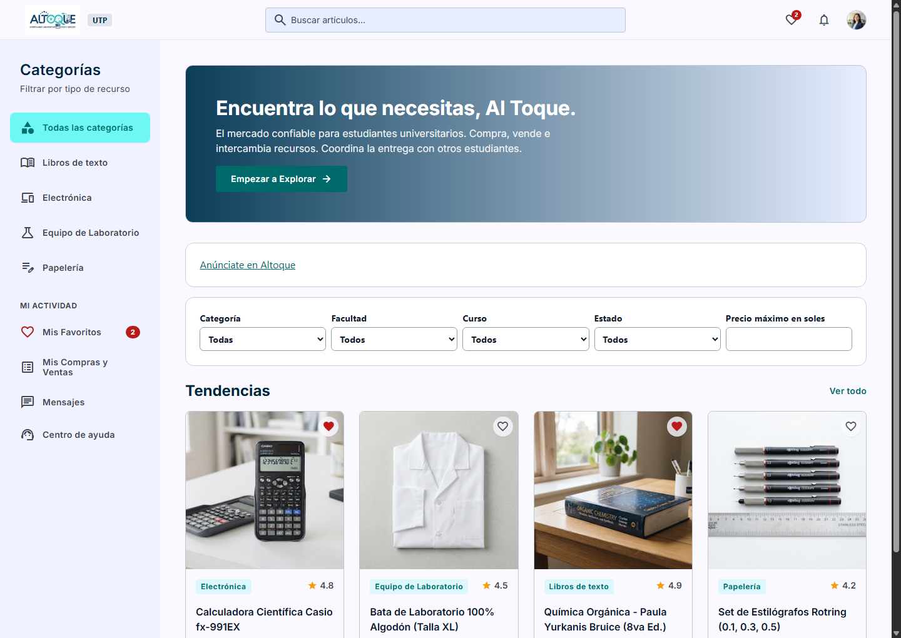
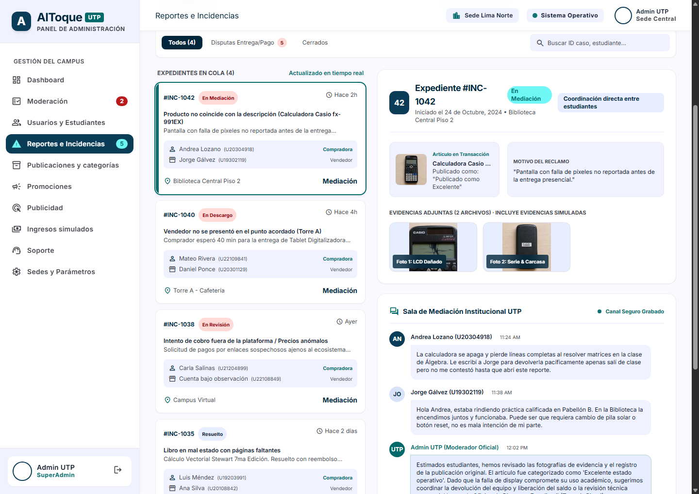

# Altoque · Mercado de Recursos Universitarios

Prototipo de Nexu S.A.C. para estudiantes de la Universidad Tecnológica del Perú, sede Lima Norte. El marketplace C2C facilita la compra, venta e intercambio de recursos académicos de segunda mano. Los estudiantes coordinan el acuerdo, el pago y la entrega entre ellos.

[Abrir Altoque en producción](https://altoque-woad.vercel.app/) · [Código fuente](https://github.com/Casey1304/Altoque)

## Problema y público objetivo

Cada ciclo, los estudiantes necesitan materiales que pueden ser costosos o difíciles de conseguir. Los grupos informales dispersan las ofertas y dificultan encontrar recursos por curso o comparar su estado. Altoque reúne las publicaciones y facilita el contacto entre estudiantes de UTP Lima Norte.

## Arquitectura

| Ruta en el repositorio | Responsabilidad |
| --- | --- |
| `src/App.jsx` | Navegación y controles de acceso por rol |
| `src/pages/` y `src/components/` | Marketplace, administración, soporte e interfaces compartidas |
| `src/services/` | Datos de demostración y persistencia local |
| `public/reportes/` | Imágenes locales y evidencias simuladas |
| `tests/` | Pruebas de rutas, roles y persistencia |
| `vercel.json` | Compilación Vite y rutas directas de la SPA |

## Instalación y ejecución

Usa Node.js 24 y npm. Desde la carpeta `react-app`:

```sh
npm ci
npm run dev
npm test
npm run lint
npm run build
```

Abre `http://localhost:5173/`. En PowerShell, usa `npm.cmd` si la política de ejecución bloquea `npm.ps1`. `npm run preview` sirve la compilación local. Una publicación estática debe devolver `index.html` para las rutas de React Router.

La app usa React 19, React Router, Vite, Tailwind CSS, CSS de componentes y Oxlint. Las pruebas se ejecutan con Node Test Runner y renderizado estático de React.

## Autenticación y cuentas de demostración

| Rol | Correo | Contraseña | Inicio |
| --- | --- | --- | --- |
| Estudiante de prueba | `cliente@altoque.com` | `Cliente123` | `/` |
| Administrador | `admin@altoque.com` | `Admin123` | `/admin` |

La cuenta de estudiante de prueba tiene una excepción al requisito institucional. Las cuentas nuevas se registran con `@utp.edu.pe` y quedan pendientes de validación simulada por un administrador. Usa contraseñas exclusivas de la demostración.

## Marketplace estudiantil

- Catálogo, búsqueda, filtros por categoría, facultad, curso, condición y precio, ficha y favoritos.
- Publicación de ventas e intercambios con fotografía. En **Mis Compras y Ventas** puedes editar, eliminar o promocionar tus publicaciones y consultar sus visualizaciones y favoritos.
- Chat, notificaciones, perfil, reporte de publicaciones e historial de operaciones. Para probar la confirmación bilateral, publica con una cuenta, regístrate con un segundo correo de prueba en el mismo navegador y registra la operación desde la ficha. Confirma el acuerdo con ambas cuentas. Cada parte puede dejar una reseña de 1 a 5 estrellas por operación completada.
- **Centro de ayuda** con consultas, problemas técnicos, solicitudes, seguimiento, respuestas y encuesta de satisfacción.
- **Anúnciate en Altoque** recibe solicitudes de negocios y muestra anuncios activos identificados como publicidad en el catálogo.

## Administración

- **Dashboard** con indicadores calculados y seguimiento de metas del informe. Las cuentas verificadas activas sirven como referencia de actividad en el prototipo. Satisfacción es el porcentaje de participantes que respondieron 4 o 5. El historial de campus conserva sus registros de demostración.
- **Usuarios y estudiantes** con búsqueda, validación simulada, suspensión y reactivación.
- **Publicaciones y categorías**, cola de moderación y reportes, con historial de acciones y motivos de retiro o restauración.
- **Promociones**, **Publicidad** e **Ingresos simulados** para gestionar planes, solicitudes, anuncios, vencimientos y consultar importes por fecha y tipo.
- **Soporte** con clasificación, prioridad, respuestas, fechas y estados. El objetivo para consultas es responder en menos de 24 horas. Los objetivos institucional y de reportes son 2 y 48 horas, respectivamente. El 99 % de disponibilidad es un objetivo del servicio. Su medición requiere monitoreo externo.

## Modelo Freemium

Publicar, buscar, contactar, negociar y registrar operaciones son gratuitos. Las fuentes de ingresos simulados de Nexu son la promoción voluntaria y la publicidad comercial. El plan básico cuesta S/ 2.00 por 3 días, el plus S/ 5.00 por 7 días y el máximo S/ 9.00 por 15 días. Administración puede ajustar precios y duración y ofrecer una promoción de bienvenida por cuenta. La etiqueta **Destacado** y la prioridad del catálogo dependen del vencimiento registrado.

## Reportes e incidencias

El administrador puede revisar reportes, consultar el historial de mediación y ampliar evidencias. Las imágenes de los cuatro expedientes de demostración se sirven desde el repositorio. Las dos evidencias del expediente #INC-1042 se identifican como simuladas.

## Datos y límites del prototipo

La capa de persistencia en `src/services/storage.js` conserva los datos por origen del navegador. Inicializa claves faltantes, mantiene el catálogo y los registros administrativos previos, y asigna a la cuenta de prueba los datos personales de versiones que carecían de propietario. Las contraseñas nuevas se guardan como verificadores de demostración. Una cuenta antigua con contraseña en texto se migra al iniciar sesión correctamente.

La sesión, roles, pagos y validación institucional se simulan íntegramente en el frontend. LocalStorage almacena los datos de la demostración por navegador y dominio. El proyecto carece de un backend de producción. No ingreses contraseñas reales, datos bancarios o documentos institucionales. Chat y datos se comparten entre las cuentas de un mismo origen y almacenamiento del navegador. Las imágenes locales tienen un límite de 1 MB por archivo y están sujetas a la cuota del navegador. Las imágenes y fuentes remotas dependen de la conectividad.

Una versión con backend debe incorporar autenticación y autorización del servidor, verificación institucional, base de datos y almacenamiento de imágenes, sincronización entre dispositivos, bitácora de auditoría y monitoreo de disponibilidad.

## Despliegue

Vercel compila la rama `main` con el preset Vite, ejecuta `npm ci` y `npm run build`, y sirve `dist/`. El repositorio de GitHub contiene el frontend en su raíz. La configuración de la SPA permite abrir directamente rutas como `/login` o `/admin/reportes`.

## Capturas de producción

**Marketplace estudiantil**



**Reportes e incidencias**



## Licencia

Consulta [LICENSE](LICENSE).
